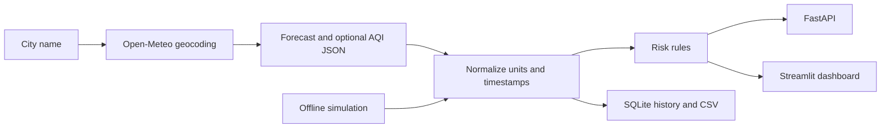

# Weather Forecast & Alert Application

A Python weather dashboard and API for city forecasts, rule-based risk alerts, saved weather history, and downloadable reports. It supports live Open-Meteo data and an offline simulation, so the project can be demonstrated without an API key or network connection.

## What it does

- Retrieves current conditions, a 48-hour forecast, a seven-day outlook, and optional air-quality data.
- Flags rain, high temperature, next-day heatwave, humidity, high wind, UV, thunderstorms, fog, and poor AQI when available.
- Serves weather and alerts through FastAPI and displays them in a Streamlit dashboard.
- Stores source payloads and normalized time-series in SQLite; exports forecast CSV files.
- Shows a location on an interactive OpenStreetMap, with temperature and rain charts.
- Offers an optional scheduled refresh and Telegram notification worker with 12-hour duplicate suppression.

This is an educational project. Its sample thresholds are not official weather or emergency warnings.

## Dashboard preview

The dashboard has a forest-green sidebar, high-contrast controls, weather summary cards, alert notices, hourly and daily charts, a full-width location map, and a seven-day forecast table. Add your own current screenshots to `images/` after starting the app; do not upload screenshots containing private paths or credentials.

## How the data flows



Wind is normalized and stored in m/s; the dashboard displays km/h for readability. Temperature uses °C, precipitation uses mm, and each place keeps its local timezone. Hourly records are sorted and duplicate timestamps are removed.

## Technology

Python 3.11+, FastAPI, Pydantic, httpx, SQLite, Streamlit, Pandas, Matplotlib, Folium, and Open-Meteo.

## Quick start

### Windows PowerShell

```powershell
py -3.11 -m venv .venv
.\.venv\Scripts\Activate.ps1
python -m pip install -r requirements.txt
python -m streamlit run dashboard.py
```

If PowerShell blocks environment activation, install and run with the environment’s Python directly:

```powershell
.\.venv\Scripts\python.exe -m pip install -r requirements.txt
.\.venv\Scripts\python.exe -m streamlit run dashboard.py
```

### macOS or Linux

```bash
python3.11 -m venv .venv
source .venv/bin/activate
python -m pip install -r requirements.txt
python -m streamlit run dashboard.py
```

In the dashboard, choose **Simulation (offline)** to see a repeatable example. Choose **Live forecast**, enter a city, and select **Get forecast** to retrieve current provider data.

## Run the other project modes

```powershell
# Offline command-line simulation and CSV report
python main.py

# FastAPI service (interactive docs at http://127.0.0.1:8000/docs)
python -m uvicorn api.app:app --reload

# Optional scheduled refresh / alert worker; stop with Ctrl+C
python -m jobs.refresh
```

Live weather uses Open-Meteo and does not need an API key. Live mode requires internet access; simulation mode works offline. Scheduled refresh checks saved live locations every two hours and alert delivery every 30 minutes by default.

## API routes

| Route | Purpose |
|---|---|
| `GET /health` | Service health |
| `GET /locations` | List saved places |
| `POST /locations?city=Pune` | Fetch and save a place |
| `GET /weather?city=Pune&mode=live` | Current conditions, forecast, and alerts |
| `GET /weather?city=Pune&mode=simulation` | Offline sample response |
| `GET /forecast/hourly?city=Pune&hours=24` | Hourly forecast (up to 48 hours) |
| `GET /forecast/daily?city=Pune&days=7` | Daily outlook (up to seven days) |
| `GET /alerts?city=Pune` | Risk notices |
| `GET /history?limit=10` | Recent saved snapshots |
| `GET /report.csv?city=Pune&mode=simulation` | Download forecast CSV |

Forecast and alert routes can use `location_id` for saved locations. Browse and try the routes at `/docs` while the API is running.

## Alert defaults

| Signal | Default rule |
|---|---|
| High temperature | Current temperature ≥ 35°C |
| Heatwave | Tomorrow’s maximum ≥ 40°C |
| Humidity | Relative humidity ≥ 85% |
| Rain | Rain probability ≥ 60% in the near-term forecast |
| Strong wind | Wind or gust ≥ 15 m/s |
| UV | Daily maximum UV ≥ 8 |
| Thunderstorm | Forecast weather code 95, 96, or 99 |
| Fog / low visibility | Visibility below 1 km |
| Air quality | European AQI ≥ 100, when supplied |

Adjust thresholds in `src/weather_app/config.py`. The API provider may not supply every optional field for every place.

## Optional Telegram alerts

1. Copy `.env.example` to `.env` and uncomment/fill `TELEGRAM_BOT_TOKEN` and `TELEGRAM_CHAT_ID`.
2. Keep `.env` private. It is excluded by `.gitignore`; only `.env.example` belongs in Git.
3. Run `python -m jobs.refresh`. The same alert rule for a location is suppressed for 12 hours after successful delivery.

No messages are sent when Telegram credentials are unset. Email and SMS are possible future adapters.

## Project structure

```text
api/                 FastAPI routes
src/weather_app/     provider, models, alert rules, storage, simulation
jobs/                scheduled refresh and optional notifier
tests/               alert and normalization checks
data/                local SQLite database (generated; ignored by Git)
outputs/              generated CSV reports (ignored by Git)
images/               optional project screenshots
reports/              supporting project material
docs/                 step-by-step guide and interview preparation
main.py                offline CLI entry point
dashboard.py           Streamlit dashboard
requirements.txt       Python dependencies
.env.example            safe template for optional credentials
.gitignore              keeps generated and sensitive files out of Git
Dockerfile              FastAPI container
```

## Example simulation output

```text
New Delhi — Built-in simulation
Current: 37.2°C, humidity 88%, wind 18.0 km/h
Alerts: heat, humidity, rain, wind, UV, thunderstorm, fog and AQI
Seven-day forecast saved to outputs/forecast_<timestamp>.csv
```

## Checks

Run the included rule and normalization checks with:

```powershell
python -m unittest discover -s tests -v
```

The checks cover rain/heat/humidity, heatwave, wind/UV/storm/fog, missing data, timestamp ordering, and m/s normalization.

## GitHub publishing

Suggested repository name: `weather-forecast-alert-application`.

Suggested description: `Python weather forecasting and risk alerts with FastAPI, Streamlit, Open-Meteo, SQLite, maps, charts, and offline simulation.`

Suggested topics: `python`, `fastapi`, `weather-api`, `streamlit`, `open-meteo`, `data-visualization`, `alert-system`.

This project folder already has a local `main` branch and starter commit. Create an empty GitHub repository under your account, then connect and publish it from this folder:

```bash
git remote add origin <your-repository-url>
git status
git push -u origin main
```

Check `git status` before the first push. `.env`, SQLite databases, and generated CSV reports should be ignored. The [project guide](docs/PROJECT_GUIDE.md) includes the full phase plan, installation details, proof-building schedule, screenshot checklist, and interview answers.
